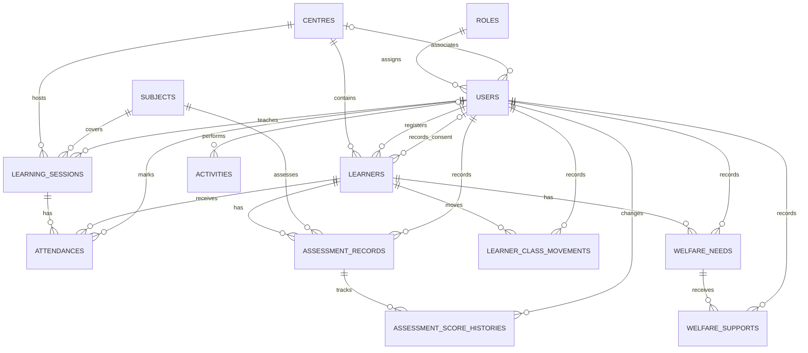

# TSANGAYA+

## Database Schema and Data Dictionary

**Project Title:** TSANGAYA+ Structured Learning, Attendance & Child Welfare Platform for Tsangaya Communities  
**Document Type:** Database Design, Schema and Data Dictionary  
**Version:** 2.0  
**Date:** 13 November 2026  
**Framework:** Laravel 13  
**Database Design:** Relational Database  
**Source of Truth:** Project database migrations and Eloquent models

---

## 1. Introduction

### 1.1 Purpose

This document describes the database structure implemented for the TSANGAYA+ platform. It identifies the principal database tables, their fields, data types, constraints, primary keys, foreign keys, and relationships.

It serves as a technical reference for developers, project supervisors, database administrators, testers, and future maintainers.

### 1.2 Scope

The database supports the following major areas:

- Staff accounts and role management.
- Tsangaya centre management.
- Learner registration and consent records.
- Learning subjects and sessions.
- Attendance recording.
- Learner assessments and score history.
- Learner class movement history.
- Welfare needs and support records.
- User activity tracking.

The document also identifies supporting Laravel framework tables.

### 1.3 Database Design Approach

TSANGAYA+ uses a relational database structure. Information is organised into related tables, with primary keys identifying individual records and foreign keys connecting related records.

Laravel Eloquent models provide the application's database interaction and relationship definitions.

The schema is based on the supplied project migrations. Physical data types may vary slightly depending on whether the application runs on SQLite, MySQL, or another compatible database system.

### 1.4 Important Implementation Notes

1. The database structure is defined by the project's migration files.
2. The `final_percentage`, `grade`, and `performance` assessment attributes are calculated by the application model; they are not stored database columns.
3. The `users` table does not contain an address column.
4. Assessment scores use `DECIMAL(5,2)`.
5. The `activities` table uses a polymorphic reference through `subject_type` and `subject_id`.
6. The three assessment stages are stored as columns within one learner-and-subject assessment record.
7. Database configuration is environment-dependent. The supplied `.env.example` specifies SQLite, while a development environment may be configured to use MySQL.

---

## 2. Database Overview

### 2.1 Main Application Tables

The application has thirteen principal tables.

| Table                        | Purpose                                              |
| ---------------------------- | ---------------------------------------------------- |
| `roles`                      | Stores system roles.                                 |
| `users`                      | Stores staff accounts and profile information.       |
| `centres`                    | Stores participating Tsangaya centre information.    |
| `learners`                   | Stores learner registration and consent information. |
| `subjects`                   | Stores programme learning subjects.                  |
| `learning_sessions`          | Stores scheduled learning sessions.                  |
| `attendances`                | Stores learner attendance records.                   |
| `assessment_records`         | Stores learner assessment scores.                    |
| `assessment_score_histories` | Tracks changes to assessment scores.                 |
| `learner_class_movements`    | Records learner movement between classes.            |
| `welfare_needs`              | Stores identified learner welfare needs.             |
| `welfare_supports`           | Records support provided for welfare needs.          |
| `activities`                 | Stores user activity information.                    |

### 2.2 Supporting Laravel Tables

The project also includes framework tables that support Laravel services.

| Table                   | Purpose                                                                 |
| ----------------------- | ----------------------------------------------------------------------- |
| `password_reset_tokens` | Supports password reset functionality.                                  |
| `sessions`              | Stores application session data when database-backed sessions are used. |
| `cache`                 | Stores database-backed cache entries.                                   |
| `cache_locks`           | Supports database-backed cache locks.                                   |
| `jobs`                  | Stores queued jobs when the database queue driver is used.              |
| `job_batches`           | Stores information about job batches.                                   |
| `failed_jobs`           | Stores information about failed queued jobs.                            |

These supporting tables are not core TSANGAYA+ programme entities.

---

## 3. Database Data Dictionary

The following sections describe the fields in the main application tables.

**Terminology:**

- **PK:** Primary Key.
- **FK:** Foreign Key.
- **UNIQUE:** Prevents duplicate values.
- **Nullable:** The field may contain `NULL`.
- **Required:** The field must contain a value.

### 3.1 Table: `roles`

**Purpose:** Stores the roles available within the system.

| Field         | Data Type       | Constraint       | Description             |
| ------------- | --------------- | ---------------- | ----------------------- |
| `id`          | BIGINT UNSIGNED | PK               | Unique role identifier. |
| `name`        | VARCHAR(255)    | UNIQUE, Required | Role name.              |
| `description` | VARCHAR(255)    | Nullable         | Short role description. |
| `created_at`  | TIMESTAMP       | Nullable         | Record creation time.   |
| `updated_at`  | TIMESTAMP       | Nullable         | Last update time.       |

The system uses three principal roles:

- Admin
- Programme Officer
- Teacher

### 3.2 Table: `users`

**Purpose:** Stores staff login accounts, role assignments, and profile information.

| Field               | Data Type       | Constraint                | Description                                  |
| ------------------- | --------------- | ------------------------- | -------------------------------------------- |
| `id`                | BIGINT UNSIGNED | PK                        | Unique user identifier.                      |
| `role_id`           | BIGINT UNSIGNED | FK → roles.id, Required   | Assigned role.                               |
| `centre_id`         | BIGINT UNSIGNED | FK → centres.id, Nullable | Associated centre, where applicable.         |
| `name`              | VARCHAR(255)    | Required                  | Staff member's name.                         |
| `email`             | VARCHAR(255)    | UNIQUE, Required          | Login email address.                         |
| `phone`             | VARCHAR(255)    | Nullable                  | Contact phone number.                        |
| `email_verified_at` | TIMESTAMP       | Nullable                  | Email verification time.                     |
| `password`          | VARCHAR(255)    | Required                  | Hashed password.                             |
| `photo`             | VARCHAR(255)    | Nullable                  | Profile photo path or reference.             |
| `gender`            | VARCHAR(255)    | Nullable                  | Optional gender information.                 |
| `qualification`     | VARCHAR(255)    | Nullable                  | Qualification information, where applicable. |
| `status`            | ENUM            | Required                  | Account status: active or inactive.          |
| `remember_token`    | VARCHAR(100)    | Nullable                  | Laravel remember-me token.                   |
| `created_at`        | TIMESTAMP       | Nullable                  | Record creation time.                        |
| `updated_at`        | TIMESTAMP       | Nullable                  | Last update time.                            |

**Relationship:** Each user belongs to one role. A user may optionally be associated with a centre.

### 3.3 Table: `centres`

**Purpose:** Stores information about participating Tsangaya centres.

| Field                      | Data Type       | Constraint | Description                           |
| -------------------------- | --------------- | ---------- | ------------------------------------- |
| `id`                       | BIGINT UNSIGNED | PK         | Unique centre identifier.             |
| `name`                     | VARCHAR(255)    | Required   | Centre name.                          |
| `location`                 | VARCHAR(255)    | Required   | Centre location.                      |
| `learner_population`       | INT UNSIGNED    | Nullable   | Recorded learner population.          |
| `internet_availability`    | VARCHAR(255)    | Nullable   | Internet availability information.    |
| `electricity_availability` | VARCHAR(255)    | Nullable   | Electricity availability information. |
| `technology_readiness`     | VARCHAR(255)    | Nullable   | Technology readiness information.     |
| `status`                   | ENUM            | Required   | Centre status: active or inactive.    |
| `created_at`               | TIMESTAMP       | Nullable   | Record creation time.                 |
| `updated_at`               | TIMESTAMP       | Nullable   | Last update time.                     |

A centre can be associated with multiple users, learners, and learning sessions.

### 3.4 Table: `learners`

**Purpose:** Stores learner identity, registration, class assignment, centre association, and consent information.

| Field                 | Data Type        | Constraint                | Description                          |
| --------------------- | ---------------- | ------------------------- | ------------------------------------ |
| `id`                  | BIGINT UNSIGNED  | PK                        | Unique learner identifier.           |
| `learner_code`        | VARCHAR(255)     | UNIQUE, Required          | Unique learner identification code.  |
| `full_name`           | VARCHAR(255)     | Required                  | Learner's full name.                 |
| `age`                 | TINYINT UNSIGNED | Nullable                  | Learner's age.                       |
| `class_group`         | ENUM             | Required                  | Class A or Class B.                  |
| `centre_id`           | BIGINT UNSIGNED  | FK → centres.id, Required | Centre to which the learner belongs. |
| `registration_date`   | DATE             | Required                  | Learner registration date.           |
| `status`              | ENUM             | Required                  | Active or inactive learner status.   |
| `registered_by`       | BIGINT UNSIGNED  | FK → users.id, Required   | User who registered the learner.     |
| `consent_status`      | ENUM             | Required                  | Pending, Granted, or Declined.       |
| `consent_date`        | DATE             | Nullable                  | Date consent was recorded.           |
| `consent_recorded_by` | BIGINT UNSIGNED  | FK → users.id, Nullable   | User who recorded consent.           |
| `created_at`          | TIMESTAMP        | Nullable                  | Record creation time.                |
| `updated_at`          | TIMESTAMP        | Nullable                  | Last update time.                    |

Learner records are associated with a centre and the staff member responsible for registration.

### 3.5 Table: `subjects`

**Purpose:** Stores the learning subjects offered through the programme.

| Field         | Data Type       | Constraint       | Description                |
| ------------- | --------------- | ---------------- | -------------------------- |
| `id`          | BIGINT UNSIGNED | PK               | Unique subject identifier. |
| `name`        | VARCHAR(255)    | UNIQUE, Required | Subject name.              |
| `description` | TEXT            | Nullable         | Subject description.       |
| `status`      | ENUM            | Required         | Active or inactive.        |
| `created_at`  | TIMESTAMP       | Nullable         | Record creation time.      |
| `updated_at`  | TIMESTAMP       | Nullable         | Last update time.          |

The programme subjects are:

- Literacy.
- Numeracy.
- Basic Modern Education.

### 3.6 Table: `learning_sessions`

**Purpose:** Stores structured learning sessions and their assignments.

| Field          | Data Type       | Constraint                 | Description                                      |
| -------------- | --------------- | -------------------------- | ------------------------------------------------ |
| `id`           | BIGINT UNSIGNED | PK                         | Unique session identifier.                       |
| `centre_id`    | BIGINT UNSIGNED | FK → centres.id, Required  | Centre hosting the session.                      |
| `subject_id`   | BIGINT UNSIGNED | FK → subjects.id, Required | Subject being taught.                            |
| `teacher_id`   | BIGINT UNSIGNED | FK → users.id, Required    | Assigned teacher account.                        |
| `class_group`  | ENUM            | Required                   | Class A or Class B.                              |
| `topic`        | VARCHAR(255)    | Required                   | Session topic.                                   |
| `session_date` | DATE            | Required                   | Scheduled session date.                          |
| `status`       | ENUM            | Required                   | Scheduled, Delivered, Cancelled, or Rescheduled. |
| `created_at`   | TIMESTAMP       | Nullable                   | Record creation time.                            |
| `updated_at`   | TIMESTAMP       | Nullable                   | Last update time.                                |

Each learning session is associated with a centre, subject, teacher, and class group.

### 3.7 Table: `attendances`

**Purpose:** Stores learner attendance information for individual learning sessions.

| Field                 | Data Type       | Constraint                          | Description                           |
| --------------------- | --------------- | ----------------------------------- | ------------------------------------- |
| `id`                  | BIGINT UNSIGNED | PK                                  | Unique attendance identifier.         |
| `learning_session_id` | BIGINT UNSIGNED | FK → learning_sessions.id, Required | Relevant learning session.            |
| `learner_id`          | BIGINT UNSIGNED | FK → learners.id, Required          | Learner whose attendance is recorded. |
| `status`              | ENUM            | Required                            | Present or Absent.                    |
| `marked_by`           | BIGINT UNSIGNED | FK → users.id, Required             | User who marked attendance.           |
| `absence_reason`      | VARCHAR(255)    | Nullable                            | Reason for absence, where recorded.   |
| `notes`               | TEXT            | Nullable                            | Additional attendance notes.          |
| `created_at`          | TIMESTAMP       | Nullable                            | Record creation time.                 |
| `updated_at`          | TIMESTAMP       | Nullable                            | Last update time.                     |

**Important constraint:** The combination of `learning_session_id` and `learner_id` is unique. This prevents duplicate attendance records for the same learner in the same session.

### 3.8 Table: `assessment_records`

**Purpose:** Stores learner assessment scores for individual subjects.

| Field            | Data Type       | Constraint                 | Description                       |
| ---------------- | --------------- | -------------------------- | --------------------------------- |
| `id`             | BIGINT UNSIGNED | PK                         | Unique assessment identifier.     |
| `learner_id`     | BIGINT UNSIGNED | FK → learners.id, Required | Assessed learner.                 |
| `subject_id`     | BIGINT UNSIGNED | FK → subjects.id, Required | Assessed subject.                 |
| `class_group`    | ENUM            | Required                   | Class A or Class B.               |
| `baseline_score` | DECIMAL(5,2)    | Nullable                   | Baseline assessment score.        |
| `midline_score`  | DECIMAL(5,2)    | Nullable                   | Midline assessment score.         |
| `endline_score`  | DECIMAL(5,2)    | Nullable                   | Endline assessment score.         |
| `recorded_by`    | BIGINT UNSIGNED | FK → users.id, Required    | User who recorded the assessment. |
| `created_at`     | TIMESTAMP       | Nullable                   | Record creation time.             |
| `updated_at`     | TIMESTAMP       | Nullable                   | Last update time.                 |

**Important constraint:** The combination of `learner_id` and `subject_id` is unique. Therefore, one learner has one assessment record per subject, with the three assessment stages stored as separate score columns.

### 3.9 Table: `assessment_score_histories`

**Purpose:** Maintains a history of changes made to learner assessment scores.

| Field                  | Data Type       | Constraint                           | Description                      |
| ---------------------- | --------------- | ------------------------------------ | -------------------------------- |
| `id`                   | BIGINT UNSIGNED | PK                                   | Unique history identifier.       |
| `assessment_record_id` | BIGINT UNSIGNED | FK → assessment_records.id, Required | Assessment record being changed. |
| `assessment_type`      | ENUM            | Required                             | Baseline, Midline, or Endline.   |
| `old_score`            | DECIMAL(5,2)    | Nullable                             | Previous score.                  |
| `new_score`            | DECIMAL(5,2)    | Required                             | New score.                       |
| `changed_by`           | BIGINT UNSIGNED | FK → users.id, Required              | User who changed the score.      |
| `created_at`           | TIMESTAMP       | Nullable                             | History creation time.           |
| `updated_at`           | TIMESTAMP       | Nullable                             | Last update time.                |

This table supports accountability and tracking of assessment score changes.

### 3.10 Table: `learner_class_movements`

**Purpose:** Records movement of learners between Class A and Class B.

| Field            | Data Type       | Constraint                 | Description                 |
| ---------------- | --------------- | -------------------------- | --------------------------- |
| `id`             | BIGINT UNSIGNED | PK                         | Unique movement identifier. |
| `learner_id`     | BIGINT UNSIGNED | FK → learners.id, Required | Learner being moved.        |
| `previous_class` | ENUM            | Required                   | Class before movement.      |
| `new_class`      | ENUM            | Required                   | Class after movement.       |
| `reason`         | TEXT            | Required                   | Reason for movement.        |
| `effective_date` | DATE            | Required                   | Date movement takes effect. |
| `recorded_by`    | BIGINT UNSIGNED | FK → users.id, Required    | User who recorded movement. |
| `created_at`     | TIMESTAMP       | Nullable                   | Record creation time.       |
| `updated_at`     | TIMESTAMP       | Nullable                   | Last update time.           |

This table preserves the history of learner class changes.

### 3.11 Table: `welfare_needs`

**Purpose:** Stores identified welfare concerns associated with learners.

| Field             | Data Type       | Constraint                 | Description                                     |
| ----------------- | --------------- | -------------------------- | ----------------------------------------------- |
| `id`              | BIGINT UNSIGNED | PK                         | Unique welfare need identifier.                 |
| `learner_id`      | BIGINT UNSIGNED | FK → learners.id, Required | Learner with the identified need.               |
| `category`        | ENUM            | Required                   | Clothing, Health, Learning Materials, or Other. |
| `description`     | TEXT            | Required                   | Description of the identified need.             |
| `status`          | ENUM            | Required                   | Open, In Progress, or Resolved.                 |
| `identified_date` | DATE            | Required                   | Date the need was identified.                   |
| `recorded_by`     | BIGINT UNSIGNED | FK → users.id, Required    | User who recorded the need.                     |
| `created_at`      | TIMESTAMP       | Nullable                   | Record creation time.                           |
| `updated_at`      | TIMESTAMP       | Nullable                   | Last update time.                               |

### 3.12 Table: `welfare_supports`

**Purpose:** Records support provided in response to identified welfare needs.

| Field             | Data Type       | Constraint                      | Description                                                    |
| ----------------- | --------------- | ------------------------------- | -------------------------------------------------------------- |
| `id`              | BIGINT UNSIGNED | PK                              | Unique support identifier.                                     |
| `welfare_need_id` | BIGINT UNSIGNED | FK → welfare_needs.id, Required | Welfare need receiving support.                                |
| `support_type`    | ENUM            | Required                        | Financial Assistance, Material Assistance, Referral, or Other. |
| `description`     | TEXT            | Required                        | Description of support provided.                               |
| `date_provided`   | DATE            | Required                        | Date support was provided.                                     |
| `recorded_by`     | BIGINT UNSIGNED | FK → users.id, Required         | User who recorded support.                                     |
| `notes`           | TEXT            | Nullable                        | Additional notes.                                              |
| `created_at`      | TIMESTAMP       | Nullable                        | Record creation time.                                          |
| `updated_at`      | TIMESTAMP       | Nullable                        | Last update time.                                              |

A welfare need can have multiple associated support records.

### 3.13 Table: `activities`

**Purpose:** Stores user activity information for system monitoring and administrative oversight.

| Field          | Data Type       | Constraint             | Description                           |
| -------------- | --------------- | ---------------------- | ------------------------------------- |
| `id`           | BIGINT UNSIGNED | PK                     | Unique activity identifier.           |
| `user_id`      | BIGINT UNSIGNED | Nullable FK → users.id | User who performed the activity.      |
| `role`         | VARCHAR(255)    | Nullable               | Role label captured at activity time. |
| `action`       | VARCHAR(255)    | Required               | Activity or action type.              |
| `subject_type` | VARCHAR(255)    | Nullable               | Model type of the affected record.    |
| `subject_id`   | BIGINT UNSIGNED | Nullable               | Identifier of the affected record.    |
| `description`  | TEXT            | Required               | Human-readable activity description.  |
| `created_at`   | TIMESTAMP       | Nullable               | Activity creation time.               |
| `updated_at`   | TIMESTAMP       | Nullable               | Last update time.                     |

The `subject_type` and `subject_id` fields form a polymorphic reference. They can identify different types of related records and do not represent a conventional foreign key to one fixed table.

The `user_id` field is nullable. If a related user account is deleted, the activity record can remain with its user reference set to NULL.

---

## 4. Database Relationships

### 4.1 Relationship Summary

| Parent Table       | Child Table                | Relationship          | Foreign Key                                     |
| ------------------ | -------------------------- | --------------------- | ----------------------------------------------- |
| roles              | users                      | One-to-many           | users.role_id                                   |
| centres            | users                      | One-to-many           | users.centre_id                                 |
| centres            | learners                   | One-to-many           | learners.centre_id                              |
| users              | learners                   | One-to-many           | learners.registered_by                          |
| users              | learners                   | One-to-many           | learners.consent_recorded_by                    |
| centres            | learning_sessions          | One-to-many           | learning_sessions.centre_id                     |
| subjects           | learning_sessions          | One-to-many           | learning_sessions.subject_id                    |
| users              | learning_sessions          | One-to-many           | learning_sessions.teacher_id                    |
| learning_sessions  | attendances                | One-to-many           | attendances.learning_session_id                 |
| learners           | attendances                | One-to-many           | attendances.learner_id                          |
| users              | attendances                | One-to-many           | attendances.marked_by                           |
| learners           | assessment_records         | One-to-many           | assessment_records.learner_id                   |
| subjects           | assessment_records         | One-to-many           | assessment_records.subject_id                   |
| users              | assessment_records         | One-to-many           | assessment_records.recorded_by                  |
| assessment_records | assessment_score_histories | One-to-many           | assessment_score_histories.assessment_record_id |
| users              | assessment_score_histories | One-to-many           | assessment_score_histories.changed_by           |
| learners           | learner_class_movements    | One-to-many           | learner_class_movements.learner_id              |
| users              | learner_class_movements    | One-to-many           | learner_class_movements.recorded_by             |
| learners           | welfare_needs              | One-to-many           | welfare_needs.learner_id                        |
| users              | welfare_needs              | One-to-many           | welfare_needs.recorded_by                       |
| welfare_needs      | welfare_supports           | One-to-many           | welfare_supports.welfare_need_id                |
| users              | welfare_supports           | One-to-many           | welfare_supports.recorded_by                    |
| users              | activities                 | One-to-many, optional | activities.user_id                              |

### 4.2 Explanation of Relationships

**Roles and Users:** One role can be assigned to multiple users, while each user has one required role.

**Centres and Users:** A centre may be associated with several staff accounts. A user's centre association is optional.

**Centres and Learners:** A centre can contain many learner records. Each learner belongs to one centre.

**Users and Learners:** A user can register many learners and can also record consent for multiple learners.

**Centres and Learning Sessions:** A centre can host many learning sessions.

**Subjects and Learning Sessions:** A subject can be associated with many learning sessions.

**Users and Learning Sessions:** A teacher can be assigned multiple learning sessions.

**Learning Sessions and Attendances:** A learning session can have many attendance records.

**Learners and Attendances:** A learner can have attendance records across multiple sessions.

**Learners and Assessment Records:** A learner can have assessment records for different subjects.

**Assessment Records and Score Histories:** One assessment record can have multiple score-change history entries.

**Learners and Class Movements:** A learner can have multiple class movement records.

**Learners and Welfare Needs:** A learner can have multiple identified welfare needs.

**Welfare Needs and Welfare Supports:** One welfare need can have multiple support records.

**Users and Activities:** A user can be associated with multiple activity records. The relationship is optional because activity records may remain after a user account is deleted.

---

## 5. Entity Relationship Diagram

The following Mermaid ERD represents the principal application tables and their relationships.

The complete ERD source is also maintained separately as `TSANGAYA_Plus_ERD.mmd`.

---

## 6. Database Constraints and Integrity Rules

The database uses constraints to protect the accuracy and consistency of stored information.

### 6.1 Primary Keys

Each principal application table has an auto-incrementing `id` primary key.

### 6.2 Unique Constraints

The following fields or field combinations are unique:

| Table              | Field or Combination             | Purpose                                                     |
| ------------------ | -------------------------------- | ----------------------------------------------------------- |
| roles              | name                             | Prevents duplicate role names.                              |
| users              | email                            | Prevents duplicate login email addresses.                   |
| learners           | learner_code                     | Ensures each learner has a unique code.                     |
| subjects           | name                             | Prevents duplicate subject names.                           |
| attendances        | learning_session_id + learner_id | Prevents duplicate attendance for a learner in one session. |
| assessment_records | learner_id + subject_id          | Allows one assessment record per learner per subject.       |

### 6.3 Foreign Key Rules

Most programme foreign keys use restrictive deletion behaviour. This protects historical records from being accidentally deleted when related records exist.

The `activities.user_id` relationship uses `SET NULL`, allowing activity information to remain when its associated user account is deleted.

### 6.4 Enumerated Values

The database restricts several fields to predefined values.

| Field                | Accepted Values                                            |
| -------------------- | ---------------------------------------------------------- |
| User status          | active, inactive                                           |
| Centre status        | active, inactive                                           |
| Learner status       | active, inactive                                           |
| Subject status       | active, inactive                                           |
| Class group          | Class A, Class B                                           |
| Session status       | Scheduled, Delivered, Cancelled, Rescheduled               |
| Attendance status    | Present, Absent                                            |
| Consent status       | Pending, Granted, Declined                                 |
| Assessment type      | Baseline, Midline, Endline                                 |
| Welfare category     | Clothing, Health, Learning Materials, Other                |
| Welfare status       | Open, In Progress, Resolved                                |
| Welfare support type | Financial Assistance, Material Assistance, Referral, Other |

---

## 7. Assessment Calculation Logic

Assessment scores are stored in the `assessment_records` table.

The application calculates three additional values through the `AssessmentRecord` model:

- `final_percentage`
- `grade`
- `performance`

These are computed attributes, not physical columns in the database.

### 7.1 Final Percentage Calculation

The final percentage is calculated as the arithmetic mean of the available assessment scores.

\[
\text{Final Percentage} =
\frac{\text{Sum of Available Scores}}{\text{Number of Available Scores}}
\]

The result is rounded to two decimal places.

If all three scores are null, the final percentage is also null.

### 7.2 Grade and Performance Classification

| Final Percentage | Grade | Performance       |
| ---------------- | ----- | ----------------- |
| 70 and above     | A     | Excellent         |
| 60 to below 70   | B     | Good              |
| 50 to below 60   | C     | Fair              |
| 40 to below 50   | D     | Needs Improvement |
| Below 40         | F     | Needs Improvement |

The calculation and grade classifications are implemented in the `AssessmentRecord` model.

### 7.3 Assessment Score History

Whenever an assessment score is changed, the `assessment_score_histories` table provides a record of:

- The assessment record affected.
- The assessment stage changed.
- The previous score.
- The new score.
- The user who made the change.
- The date and time of the history record.

This supports transparency and accountability in academic record management.

---

## 8. Database Operations and Data Flow

### 8.1 User Registration and Authentication

1. The user account is stored in the `users` table.
2. The account is associated with a role through `role_id`.
3. The authentication process verifies the user's credentials.
4. The application uses the assigned role to determine permitted access.

### 8.2 Learner Registration

1. The Programme Officer submits learner information.
2. The system validates the submitted information.
3. The learner record is saved in `learners`.
4. The learner is associated with a centre through `centre_id`.
5. The registering user is identified through `registered_by`.
6. Consent information is stored in the corresponding consent fields.

### 8.3 Learning Session Creation

1. The Admin creates a session.
2. The system associates the session with a centre.
3. The subject is linked through `subject_id`.
4. The teacher is linked through `teacher_id`.
5. The class group, topic, date, and status are saved.

### 8.4 Attendance Recording

1. The Teacher opens an assigned learning session.
2. The relevant learners are retrieved.
3. Attendance statuses are submitted.
4. The system saves the information in `attendances`.
5. The attendance record identifies the session, learner, and user who marked it.

### 8.5 Assessment Recording

1. The Teacher selects the relevant learner and subject.
2. The assessment score is submitted.
3. The system stores the score in `assessment_records`.
4. If a score is changed, the corresponding history is maintained in `assessment_score_histories`.
5. The application calculates the relevant performance attributes.

### 8.6 Welfare Management

1. The Programme Officer selects a learner.
2. A welfare need is recorded in `welfare_needs`.
3. The need is associated with the learner and recording user.
4. If support is provided, the details are stored in `welfare_supports`.
5. The system maintains the relationship between the need and its support records.

---

## 9. Operational and Maintenance Considerations

### 9.1 Database Backups

Regular database backups should be maintained to protect programme records.

Where SQLite is used, the database file should be backed up. Where MySQL is used, an appropriate database export or backup process should be configured.

Uploaded profile images and other stored files should also be included in backup planning.

### 9.2 Data Protection

Learner information, consent records, assessment scores, and welfare information should only be accessible to authorised personnel.

Database credentials and other sensitive configuration details must not be committed to public source control.

### 9.3 Record Deletion

Users, centres, learners, sessions, and assessment records should not be deleted casually because other records may depend on them.

Where appropriate, existing status fields can be used to deactivate records while preserving historical information.

### 9.4 Database Migration

When the database structure changes, developers should create new Laravel migration files rather than editing migrations that have already been applied in shared environments.

Before deployment, migration compatibility and foreign-key behaviour should be tested using the intended database driver.

---

## 10. Known Schema Considerations

The following points are important for future development and maintenance.

| Area                  | Implementation Consideration                                                                                        |
| --------------------- | ------------------------------------------------------------------------------------------------------------------- |
| User address          | No address column is defined in the supplied users migrations.                                                      |
| Assessment scores     | DECIMAL(5,2) is used; accepted score ranges must also be validated by application rules.                            |
| Assessment uniqueness | One record exists per learner and subject, with three assessment stages stored in that record.                      |
| Final performance     | Calculated by the application model rather than stored as database columns.                                         |
| Class movement        | The table records previous class, new class, reason, effective date, and recorder.                                  |
| Consent               | Consent recording user and date can be nullable.                                                                    |
| Activities            | The subject reference is polymorphic and is not a conventional foreign key to a single table.                       |
| Database driver       | The active driver depends on the environment configuration.                                                         |
| Seeders               | RoleSeeder and SubjectSeeder are separate seeders and should be included in the appropriate initialisation process. |

---

## 11. Conclusion

The TSANGAYA+ database is structured to support the platform's core operations, including staff administration, centre management, learner registration, learning session coordination, attendance, assessment tracking, and learner welfare monitoring.

The use of relational tables, primary keys, foreign keys, unique constraints, and defined relationships helps maintain consistency and provides a foundation for future system improvements.

The database design also supports accountability through registration references, attendance markers, assessment score history, welfare support records, and activity tracking.

This document provides a technical reference for understanding, maintaining, and extending the TSANGAYA+ database.

---

## 12. Related Technical Files

The following project files should be consulted alongside this document:

| File or Directory                 | Purpose                                                |
| --------------------------------- | ------------------------------------------------------ |
| `database/migrations/`            | Defines the database schema and migration history.     |
| `database/seeders/`               | Defines initial reference data and seeding operations. |
| `app/Models/`                     | Contains Eloquent models and database relationships.   |
| `app/Models/AssessmentRecord.php` | Contains assessment calculation logic.                 |
| `TSANGAYA_Plus_ERD.mmd`           | Contains the Mermaid entity relationship diagram.      |
| `README_TSANGAYA_PLUS.md`         | Provides project setup and technical orientation.      |
