# TSANGAYA+

## SYSTEM DESIGN AND ARCHITECTURE DOCUMENT

**Project Title:** Structured Learning, Attendance and Child Welfare Management Platform for Tsangaya Communities

**Prepared by:** TSANGAYA+ Development Team  
**Software Development Lead:** Asmau Maharazu  
**Document Version:** 1.0  
**Date:** 13 November 2026  
**Document Status:** Implementation-based technical documentation

---

# DOCUMENT CONTROL

| Item              | Description                              |
| ----------------- | ---------------------------------------- |
| Document title    | TSANGAYA+ System Design and Architecture |
| Version           | 1.0                                      |
| Project           | TSANGAYA+                                |
| Architecture type | Client-server web application            |
| Backend           | Laravel 13                               |
| Frontend          | React, TypeScript and Inertia.js         |
| UI framework      | Tailwind CSS and shadcn/ui               |
| Database          | Relational database                      |
| Status            | Implementation-based documentation       |

# 1. INTRODUCTION

## 1.1 Purpose

This document describes the technical design and architecture of the TSANGAYA+ application.

It explains the organisation of the application, its major software components, database architecture, communication between the frontend and backend, user access structure and principal system workflows.

It also provides a proposed architectural direction for future improvements, particularly Progressive Web Application (PWA) support and offline functionality.

The document is intended for developers, supervisors, technical reviewers, system administrators and future maintainers.

## 1.2 System Overview

TSANGAYA+ is a web-based application developed to support the management of structured learning activities, learner attendance, assessments and welfare information within Tsangaya communities.

The application uses a client-server architecture.

Users interact with the application through a web browser. The React frontend communicates with the Laravel backend through Inertia.js. Laravel processes requests, enforces application rules and interacts with the relational database.

The application provides different interfaces and permissions for:

- Admin
- Programme Officer
- Teacher

## 1.3 Architectural Objectives

The architecture is designed to:

1. Separate frontend presentation from backend business logic.
2. Provide centralised management of programme information.
3. Enforce role-based access control.
4. Maintain relationships between programme records.
5. Support modular development and maintenance.
6. Provide reusable user interface components.
7. Maintain data integrity through database relationships and validation.
8. Allow future expansion without requiring a complete system redesign.

# 2. TECHNOLOGY ARCHITECTURE

## 2.1 Technology Stack

| Layer            | Technology                   | Responsibility                                  |
| ---------------- | ---------------------------- | ----------------------------------------------- |
| Presentation     | React                        | User interface and interactive pages            |
| Programming      | TypeScript                   | Frontend application logic and type definitions |
| Integration      | Inertia.js                   | Communication between Laravel and React         |
| Styling          | Tailwind CSS                 | Responsive interface styling                    |
| UI components    | shadcn/ui                    | Reusable interface components                   |
| Icons            | Lucide                       | Interface iconography                           |
| Backend          | Laravel 13                   | Application logic and request processing        |
| Backend language | PHP                          | Server-side programming                         |
| Database access  | Laravel Eloquent ORM         | Database queries and relationships              |
| Database         | Relational database          | Persistent information storage                  |
| Routing          | Laravel routes and Wayfinder | Backend routing and frontend route helpers      |
| Asset bundling   | Vite                         | Frontend asset compilation                      |
| Version control  | Git and GitHub               | Source code management                          |

## 2.2 Why These Technologies Were Selected

### Laravel

Laravel provides the backend framework for the application.

It handles:

- Request processing.
- Authentication.
- Middleware.
- Validation.
- Database interactions.
- Application routing.
- Business logic.
- Data relationships.

### React

React provides the frontend interface.

It supports reusable components, interactive pages and dynamic presentation of application information.

### Inertia.js

Inertia.js connects the Laravel backend with the React frontend without requiring the project to be developed as two completely separate applications.

Laravel controllers return the relevant page information, which Inertia makes available to React pages.

### Tailwind CSS and shadcn/ui

Tailwind CSS supports responsive styling, while shadcn/ui provides reusable interface components.

Together, they help maintain a consistent design across the application.

### MySQL / Relational Database

The application uses a relational data model. The deployment database driver is determined by the environment configuration.

The database design uses relationships, primary keys, foreign keys and unique constraints to maintain structured records.

# 3. HIGH-LEVEL SYSTEM ARCHITECTURE

## 3.1 Current Architecture

The current TSANGAYA+ architecture follows a layered client-server design.

The major layers are:

1. Presentation layer.
2. Application and business logic layer.
3. Data access layer.
4. Database layer.

### Architecture Diagram

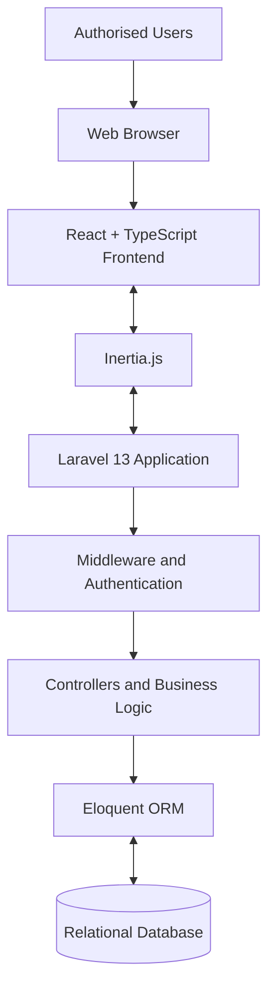

## 3.2 Presentation Layer

The presentation layer is responsible for displaying information and allowing users to interact with the application.

It includes:

- Landing page.
- Login page.
- Admin dashboard.
- Programme Officer dashboard.
- Teacher dashboard.
- User management pages.
- Centre management pages.
- Learner management pages.
- Learning session pages.
- Attendance pages.
- Assessment pages.
- Welfare pages.

The presentation layer uses React components and reusable UI elements.

## 3.3 Application Layer

The application layer is responsible for processing user requests and enforcing application rules.

It includes:

- Laravel controllers.
- Authentication mechanisms.
- Role middleware.
- Validation rules.
- Application models.
- Business logic.
- Route definitions.

For example, when a Teacher records attendance, the backend validates the request, checks the relevant permissions and stores the attendance record.

## 3.4 Data Access Layer

Laravel Eloquent ORM provides the application's object-relational mapping functionality.

It allows the application to:

- Retrieve records.
- Create records.
- Update records.
- Delete records where permitted.
- Define relationships.
- Apply query conditions.
- Interact with the database.

## 3.5 Database Layer

The database layer stores the application's persistent information.

It contains records relating to users, roles, centres, learners, subjects, learning sessions, attendance, assessments, welfare and activities.

# 4. APPLICATION COMPONENT ARCHITECTURE

## 4.1 Backend Components

The backend is organised around the Model-View-Controller (MVC) architectural pattern, with Inertia.js providing the frontend integration.

### Models

Models represent application entities and their database relationships.

Principal models include:

- User
- Role
- Centre
- Learner
- Subject
- LearningSession
- Attendance
- AssessmentRecord
- AssessmentScoreHistory
- LearnerClassMovement
- WelfareNeed
- WelfareSupport
- Activity

### Controllers

Controllers handle requests and coordinate application operations.

Controller responsibilities include:

- Authentication-related operations.
- Dashboard information.
- User management.
- Centre management.
- Learner registration.
- Learning session management.
- Attendance recording.
- Assessment management.
- Welfare management.
- Activity monitoring.

### Middleware

Middleware controls access to protected routes.

The application uses authentication and role-based middleware to restrict access according to the user's assigned role.

### Routes

Laravel routes define the application's available endpoints and connect incoming requests to their corresponding controllers.

Wayfinder provides frontend route helpers generated from backend route definitions.

## 4.2 Frontend Components

The frontend is organised into pages, layouts, reusable components and route helpers.

### Pages

React pages represent individual application screens.

Examples include:

- Dashboard pages.
- User management pages.
- Learner management pages.
- Session management pages.
- Attendance pages.
- Assessment pages.
- Welfare pages.

### Layouts

Layouts provide shared interface structures, including navigation and page organisation.

### Reusable Components

The application uses shadcn/ui components to support consistent presentation.

Examples include:

- Buttons.
- Cards.
- Tables.
- Dialogs.
- Forms.
- Badges.
- Avatars.
- Dropdown menus.

# 5. ROLE-BASED ACCESS ARCHITECTURE

The system implements three principal roles.

## 5.1 Role Structure

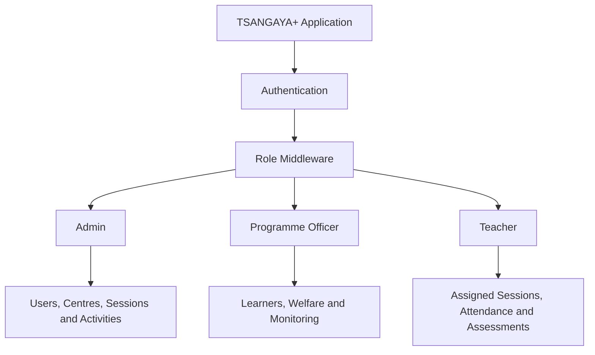

## 5.2 Admin Access

Admin manages administrative operations, including:

- User accounts.
- Centre records.
- Learning sessions.
- Overall system activities.
- Administrative settings where implemented.

Admin does not perform routine learner registration or welfare management.

## 5.3 Programme Officer Access

Programme Officers manage:

- Learner registration.
- Learner records.
- Welfare needs.
- Welfare support.
- Programme monitoring.
- Teacher activity monitoring.

They do not directly edit teachers' attendance and assessment records through the monitoring functions.

## 5.4 Teacher Access

Teachers manage their assigned teaching activities.

These include:

- Viewing assigned sessions.
- Viewing relevant learners.
- Recording attendance.
- Recording assessment scores.
- Reviewing relevant academic information.

Teachers should only access information within their authorised responsibilities.

## 5.5 Access Control Principle

Role-based access control is enforced at the backend.

Hiding a navigation item or button on the frontend is not sufficient to protect a function.

The backend must validate the authenticated user's permissions before processing protected operations.

# 6. DATABASE ARCHITECTURE

## 6.1 Database Design Overview

The database follows a relational structure.

Each major programme entity is represented by a table.

Relationships between tables are maintained using primary keys and foreign keys.

Laravel Eloquent models provide the application-level representation of these relationships.

## 6.2 Principal Database Entities

| Table                      | Responsibility                                             |
| -------------------------- | ---------------------------------------------------------- |
| roles                      | Defines application roles                                  |
| users                      | Stores staff accounts and profile information              |
| centres                    | Stores Tsangaya centre information                         |
| learners                   | Stores learner registration and identification information |
| subjects                   | Stores programme learning subjects                         |
| learning_sessions          | Stores scheduled learning activities                       |
| attendances                | Stores learner attendance                                  |
| assessment_records         | Stores assessment scores                                   |
| assessment_score_histories | Tracks assessment score changes                            |
| learner_class_movements    | Tracks class movement history                              |
| welfare_needs              | Stores identified welfare needs                            |
| welfare_supports           | Stores support actions                                     |
| activities                 | Stores system activity information                         |

Laravel infrastructure tables support authentication, sessions, cache and queued jobs where configured.

## 6.3 Entity Relationship Overview

The main relationships include:

- One role can be associated with many users.
- One centre can have many users, learners and learning sessions.
- One user can register many learners.
- One subject can have many learning sessions and assessment records.
- One teacher can be assigned many learning sessions.
- One learning session can have many attendance records.
- One learner can have many attendance records.
- One learner can have many assessment records.
- One assessment record can have multiple score-history entries.
- One learner can have multiple class movement records.
- One learner can have multiple welfare needs.
- One welfare need can have multiple support records.
- Users can record different programme activities.

## 6.4 Database Relationship Diagram

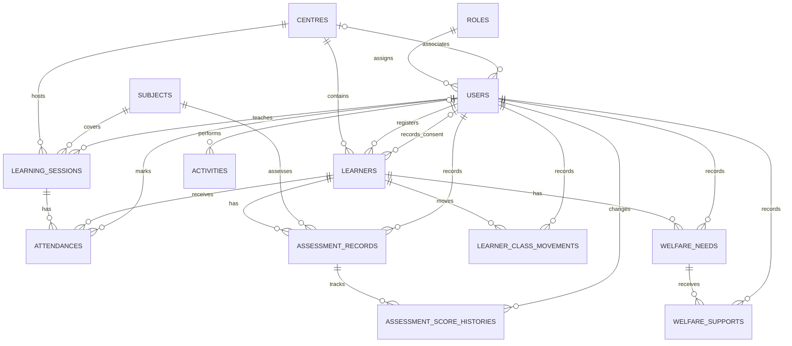

The complete column-level data dictionary and database constraints are maintained in the separate Database Design and Schema Document.

## 6.5 Important Data Integrity Rules

The current database design includes important integrity constraints.

These include:

- Unique learner identification codes.
- Unique user email addresses.
- Unique centre and subject identifiers where defined.
- One attendance record per learner per learning session.
- One assessment record per learner per subject.
- Foreign key relationships between related programme records.
- Preservation of important linked records through restrictive deletion rules where configured.

The assessment table stores Baseline, Midline and Endline scores on the same learner-subject assessment record.

Final percentage, grade and performance are calculated application attributes rather than separate persisted database columns.

# 7. INFORMATION FLOW AND PROCESS ARCHITECTURE

## 7.1 Authentication Flow

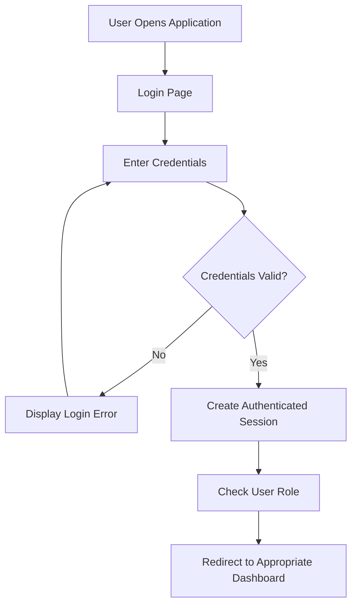

## 7.2 Learner Registration Flow

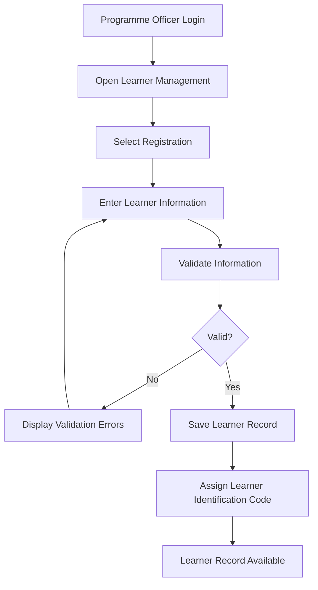

## 7.3 Learning Session Flow

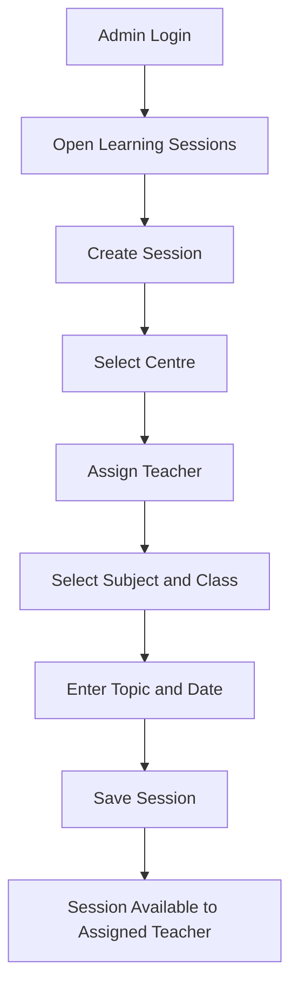

## 7.4 Attendance Flow

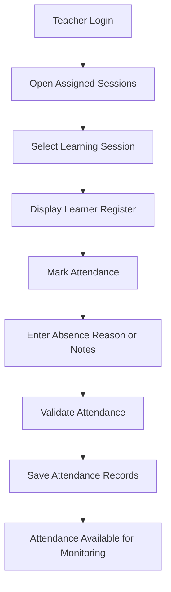

## 7.5 Assessment Flow

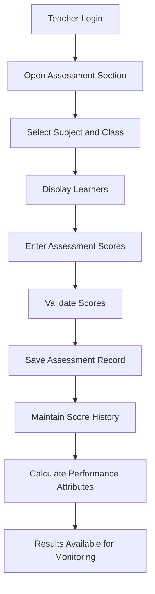

## 7.6 Welfare Management Flow

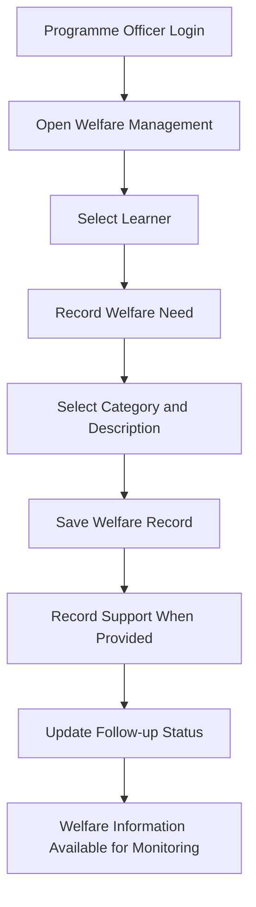

# 8. SECURITY ARCHITECTURE

## 8.1 Authentication

The application requires user authentication before accessing protected application features.

## 8.2 Authorisation

Role-based middleware and backend permission checks restrict access to authorised operations.

## 8.3 Password Protection

Passwords are handled through Laravel's authentication and hashing mechanisms.

## 8.4 Data Protection

Learner and welfare information should only be accessed by authorised personnel.

## 8.5 Environment Configuration

Application secrets and database credentials are maintained through environment configuration.

The actual `.env` file must not be committed to a public source code repository.

Production deployment should use:

- HTTPS.
- Secure database credentials.
- `APP_DEBUG=false`.
- Appropriate session configuration.
- Restricted server access.
- Regular database backups.

## 8.6 Database Integrity

Foreign keys, unique constraints and application validation help maintain the consistency of programme information.

# 9. DEPLOYMENT ARCHITECTURE

## 9.1 Current Development Environment

The application was developed and tested in a local development environment.

The development setup uses:

- Laravel application server.
- Vite development server.
- PHP runtime.
- Node.js and npm.
- Configured relational database.
- Web browser.

## 9.2 Proposed Production Deployment

For operational deployment, the recommended environment includes:

1. A secure web hosting environment or application server.
2. PHP runtime compatible with Laravel 13.
3. Web server such as Nginx or Apache.
4. Relational database server.
5. HTTPS certificate.
6. Secure environment configuration.
7. Database backup mechanism.
8. Application monitoring and maintenance procedures.

## 9.3 Deployment Flow

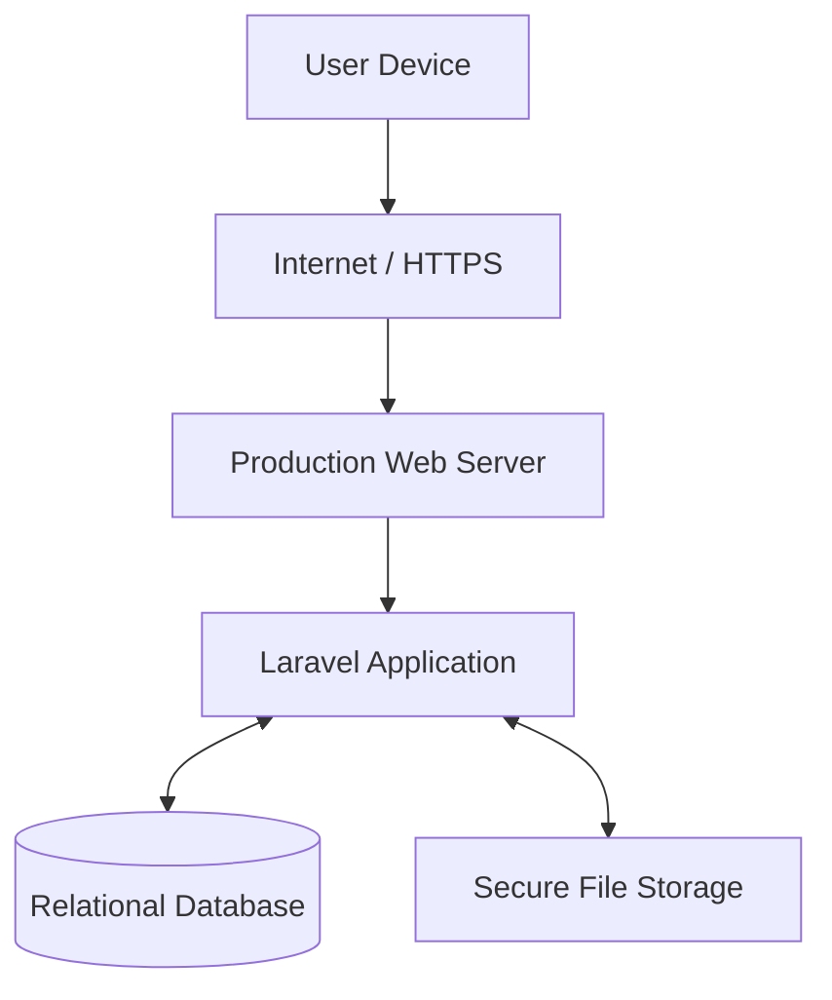

This is the recommended production arrangement. It should not be interpreted as confirmation that a production server has already been deployed.

# 10. FUTURE ARCHITECTURE: PWA AND OFFLINE FUNCTIONALITY

## 10.1 Overview

A future development phase should extend TSANGAYA+ into a Progressive Web Application.

This is intended to improve accessibility in communities where internet connectivity may be unreliable.

The PWA approach would retain the existing Laravel backend and database while introducing additional browser-based capabilities.

## 10.2 Proposed Components

Future architecture may include:

**Web App Manifest**

Defines the application name, icons, display mode and installation-related information.

**Service Worker**

Manages appropriate caching strategies and supports offline application resources.

**IndexedDB**

Provides browser-based storage for selected records captured while offline.

**Synchronisation Layer**

Manages pending local records and submits them to the central Laravel application when connectivity becomes available.

**Conflict Management**

Handles cases where local information conflicts with information already stored on the server.

## 10.3 Proposed PWA Architecture Diagram

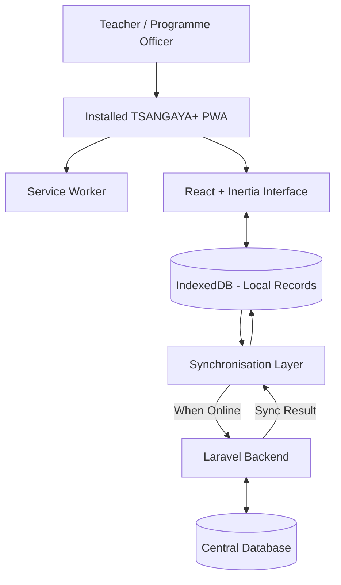

## 10.4 Proposed Offline Attendance Workflow

1. The Teacher opens the installed application.
2. Previously cached resources are loaded.
3. The Teacher accesses an approved offline attendance register.
4. Attendance entries are saved locally.
5. The application marks the records as pending synchronisation.
6. Connectivity returns.
7. The synchronisation layer submits pending records.
8. Laravel validates user permissions and record information.
9. The backend stores accepted records.
10. The application updates the synchronisation status.

## 10.5 Offline Data Integrity

The future implementation should account for:

- Duplicate submissions.
- Conflicting updates.
- Interrupted synchronisation.
- Expired authentication sessions.
- Device loss or shared-device access.
- Incomplete submissions.
- Invalid records.
- Failed synchronisation attempts.

Sensitive learner information should not be stored locally without suitable protection and a clearly defined retention policy.

## 10.6 Recommended Implementation Stages

| Stage   | Proposed work                                   |
| ------- | ----------------------------------------------- |
| Stage 1 | PWA manifest, icons and installation            |
| Stage 2 | Service worker and safe resource caching        |
| Stage 3 | Basic offline application experience            |
| Stage 4 | IndexedDB-based offline attendance              |
| Stage 5 | Secure synchronisation with Laravel             |
| Stage 6 | Conflict handling and broader offline workflows |
| Stage 7 | Device testing and field evaluation             |

All stages in this section are proposed future development work.

# 11. SCALABILITY AND MAINTAINABILITY

## 11.1 Scalability

The architecture supports the addition of further Tsangaya centres, staff accounts and learners through the existing relational data structure.

Future scaling should consider:

- Database indexing.
- Efficient queries.
- Pagination.
- Server capacity.
- File storage management.
- Backup and recovery.
- Monitoring of application performance.

## 11.2 Maintainability

The system uses a modular application structure to support future development.

Developers should:

- Follow existing Laravel conventions.
- Preserve model relationships.
- Validate backend permissions.
- Use migrations for database changes.
- Reuse existing UI components.
- Maintain route consistency.
- Update relevant documentation after changing application behaviour.

## 11.3 Extensibility

Potential future modules include:

- Advanced programme reporting.
- Expanded analytics.
- PWA support.
- Offline attendance.
- Additional monitoring tools.
- Approved external system integrations.

# 12. ARCHITECTURAL DECISIONS AND DESIGN CONSIDERATIONS

| Decision                       | Reason                                                                            |
| ------------------------------ | --------------------------------------------------------------------------------- |
| Laravel backend                | Structured server-side application development                                    |
| React frontend                 | Interactive and reusable interface                                                |
| Inertia.js integration         | Connects Laravel and React without requiring a separate frontend API architecture |
| Relational database            | Maintains structured programme records and relationships                          |
| Role-based middleware          | Restricts access to authorised operations                                         |
| shadcn/ui                      | Provides reusable interface components                                            |
| Modular controllers and models | Improves maintainability                                                          |
| Future PWA architecture        | Supports improved accessibility and potential offline operation                   |

# 13. CONCLUSION

TSANGAYA+ uses a layered client-server architecture built around Laravel, React, Inertia.js and a relational database.

The architecture separates presentation, application logic and data management while providing role-specific access to administrative, learning and welfare functions.

Its database structure supports the relationships required to manage centres, staff, learners, sessions, attendance, assessments and welfare records.

The architecture also provides a foundation for future development without requiring the complete replacement of the current system.

A particularly important future improvement is the introduction of Progressive Web Application functionality and selected offline workflows.

This will allow future versions of TSANGAYA+ to better support communities with limited internet connectivity while maintaining the existing centralised Laravel application and database.

---

# APPENDIX A: RELATED DOCUMENTATION

This document should be read alongside:

1. TSANGAYA+ Software Requirements Specification.
2. TSANGAYA+ Database Design and Schema Document.
3. TSANGAYA+ Entity Relationship Diagram.
4. TSANGAYA+ README and Installation Guide.
5. TSANGAYA+ Functional Specification and Use Cases.
6. TSANGAYA+ System User Manual.
7. TSANGAYA+ Testing Documentation.

# APPENDIX B: ARCHITECTURE TERMINOLOGY

| Term                       | Meaning                                                                           |
| -------------------------- | --------------------------------------------------------------------------------- |
| Client-server architecture | A structure in which client devices communicate with a central application server |
| MVC                        | Model-View-Controller architectural pattern                                       |
| ORM                        | Object-Relational Mapping                                                         |
| Eloquent                   | Laravel's ORM                                                                     |
| Middleware                 | Software that processes requests before they reach application handlers           |
| Inertia.js                 | Technology connecting server-side routing and frontend frameworks                 |
| PWA                        | Progressive Web Application                                                       |
| Service Worker             | Browser script that supports caching and offline-related capabilities             |
| IndexedDB                  | Browser-based database for structured local storage                               |
| Synchronisation            | Process of exchanging locally stored information with a central server            |
| ERD                        | Entity Relationship Diagram                                                       |
| API                        | Application Programming Interface                                                 |
